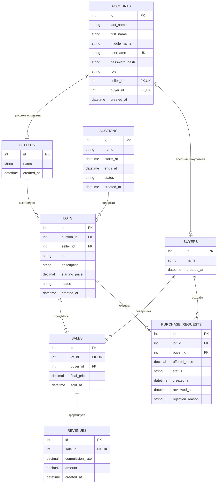

# Аукционы

Приложение для учёта аукционов с веб-интерфейсом и HTTP API. Покупатель отправляет заявку на лот, а администратор подтверждает или отклоняет её.

## Технологии

- Python 3.12.5 для локального окружения (диапазон совместимости проекта: 3.12–3.13);
- PostgreSQL 14.20;
- FastAPI 0.141.1 и Uvicorn 0.52.4;
- SQLAlchemy 2.0.52, Alembic 1.20.0 и psycopg 3.3.5;
- Pydantic Settings 2.15.0, itsdangerous 2.2.0;
- httpx 0.28.1, pytest 8.4.2, pytest-cov 7.1.0 и Ruff 0.16.7 — для разработки;
- Bandit 1.9.4 — SAST, defusedxml 0.7.1 — защищённый разбор XML-отчётов;
- uv 0.10.7 и GNU Make.

Основные и dev-зависимости закреплены точными версиями в `pyproject.toml`, включая транзитивные зависимости — в `uv.lock`. Python для команд uv закреплён в `.python-version`; версии Python, uv и PostgreSQL указаны в `.tool-versions` для настройки инструментов (например, через asdf с соответствующими плагинами). PostgreSQL и uv устанавливаются отдельно.

Все команды Makefile используют `--locked`: при рассогласовании `pyproject.toml` и `uv.lock` выполнение завершается с ошибкой. `make quality` дополнительно проверяет lock-файл командой `uv lock --check`. Обновление версии выполняется отдельным изменением: изменить ограничение в `pyproject.toml`, выполнить `uv lock` и `make verify`, закоммитить оба файла.

## Подготовка окружения

Для запуска необходимы Python 3.12.5, uv, GNU Make и запущенный PostgreSQL. Выполните единую команду первоначальной настройки:

```bash
make setup
```

Команда устанавливает зависимости из `uv.lock` в окружение Python 3.12.5, создаёт `.env` из `.env.example`, создаёт отсутствующие роль и базу PostgreSQL и применяет все миграции Alembic. Если `.env` уже существует, его настройки сохраняются. Повторный запуск не удаляет данные, не меняет пароли существующих ролей и применяет только новые миграции.

По умолчанию используются настройки `.env.example`. Для другой конфигурации заранее создайте `.env` и измените `DATABASE_URL` либо передайте эту переменную окружения. Файл `.env` содержит локальные настройки и не должен попадать в Git; созданный сценарием файл доступен только владельцу.

Если БД ещё нет, сценарий подключается к служебной БД `postgres` на том же сервере от имени текущего пользователя ОС. Этой роли нужны права создания ролей и БД. Для другого административного подключения задайте `SETUP_DATABASE_URL` (обычный URI `postgresql://...`, без `+psycopg`) в окружении перед `make setup`. Подключение должно указывать на тот же сервер PostgreSQL. Если БД уже доступна пользователю приложения, административное подключение не требуется.

PostgreSQL нужно установить и запустить заранее. Сценарий не устанавливает системные программы и не запускает сервер БД. Для последующего применения миграций отдельно доступна команда `make migrate`.

## Запуск

Запустите приложение:

```bash
make run
```

После запуска доступны:

- веб-интерфейс: <http://127.0.0.1:8000>;
- API: <http://127.0.0.1:8000>;
- Swagger UI: <http://127.0.0.1:8000/docs>;
- проверка работоспособности: <http://127.0.0.1:8000/health>.

## HTTP API

| Метод  | Адрес                    | Назначение                             |
| ------ | ------------------------ | -------------------------------------- |
| `GET`  | `/health`                | Проверить работоспособность приложения |
| `POST` | `/sellers`               | Создать продавца                       |
| `GET`  | `/sellers`               | Получить список продавцов              |
| `GET`  | `/sellers/{seller_id}`   | Получить продавца                      |
| `POST` | `/buyers`                | Создать покупателя                     |
| `GET`  | `/buyers`                | Получить список покупателей            |
| `GET`  | `/buyers/{buyer_id}`     | Получить покупателя                    |
| `POST` | `/auctions`              | Создать аукцион                        |
| `GET`  | `/auctions`              | Получить список аукционов              |
| `GET`  | `/auctions/{auction_id}` | Получить аукцион                       |
| `POST` | `/lots`                  | Создать лот                            |
| `GET`  | `/lots`                  | Получить список лотов                  |
| `GET`  | `/lots/{lot_id}`         | Получить лот                           |
| `POST` | `/sales`                 | Зарегистрировать продажу лота          |
| `GET`  | `/sales`                 | Получить список продаж                 |
| `GET`  | `/sales/{sale_id}`       | Получить продажу                       |
| `GET`  | `/revenues`              | Получить список доходов                |
| `GET`  | `/revenues/{revenue_id}` | Получить доход                         |
| `POST` | `/web/buyer/purchase-requests` | Отправить заявку на покупку      |
| `POST` | `/web/admin/purchase-requests/{id}/approve` | Подтвердить продажу |
| `POST` | `/web/admin/purchase-requests/{id}/reject` | Отклонить заявку с причиной    |

Форматы запросов и ответов можно посмотреть и проверить через Swagger UI.

Все предметные маршруты API требуют входа через `/auth/login` (cookie-сессия).
Управление участниками и аукционами, регистрация продаж и просмотр доходов
доступны администратору. Продавец видит свои лоты и продажи, покупатель —
доступные лоты и свои продажи. Эти ограничения действуют и при запросах по ID.
При открытии защищённого адреса в браузере без входа происходит переход на
`/login`. Программные API-запросы без сессии получают `401`, а при
недостаточных правах — `403`.

## Веб-интерфейс и роли

Откройте <http://127.0.0.1:8000>. При первом входе создаётся администратор с
логином и паролем из `ADMIN_USERNAME` и `ADMIN_PASSWORD` в `.env`. Перед
развёртыванием обязательно замените демонстрационные значения и `SESSION_SECRET`.

- Администратор создаёт учётную запись с ролью `admin` или `user`.
- Существующего пользователя с ролью `user` администратор регистрирует как
  продавца либо покупателя; ФИО переносится из учётной записи.
- Пользователь-продавец видит только свои лоты и может выставлять новые.
- Пользователь-покупатель видит доступные лоты, свои продажи и может оформить покупку.
- Покупатель отправляет заявку с предложенной ценой. До решения администратора она имеет статус `pending`; подтверждение создаёт продажу и доход, отклонение сохраняет заявку и оставляет лот доступным.
- Администратор видит учётные записи, участников, продажи и доходы; пользователь без профиля продавца или покупателя может просматривать список аукционов.

На маршрутах `/web/*` сервер проверяет сессию, роль и связь учётной записи с продавцом или покупателем. Веб-интерфейс состоит из страницы входа `/login` и кабинета `/app`; выход выполняется через `POST /auth/logout`.

Основные маршруты кабинета: `GET /auth/me`, `GET /web/auctions`, `/web/lots`, `/web/sales`, `/web/purchase-requests`; администратору также доступны `GET /web/revenues`, `/web/admin/accounts`, `/web/admin/sellers`, `/web/admin/buyers`, создание учётных записей, участников и аукционов, подтверждение и отклонение заявок. Продавец создаёт лот через `POST /web/seller/lots`.

API использует следующие основные коды ответа:

- `200 OK` — запрос успешно выполнен;
- `201 Created` — сущность создана;
- `400 Bad Request` — запрос нарушает бизнес-правило;
- `404 Not Found` — сущность не найдена;
- `409 Conflict` — данные конфликтуют с существующей записью;
- `422 Unprocessable Entity` — запрос не прошёл проверку.

## Правила регистрации продажи

- покупатель создаёт заявку, но это ещё не считается продажей;
- продажа и доход создаются только после подтверждения заявки администратором;
- при отклонении администратор указывает причину от 1 до 500 символов; пробелы по краям удаляются;
- отклонённая заявка и причина сохраняются в истории, а лот остаётся доступным;
- лот и покупатель должны существовать;
- один лот можно продать только один раз;
- итоговая цена не может быть ниже начальной цены лота;
- продажа, доход организатора и статус лота сохраняются одной транзакцией;
- доход рассчитывается по `COMMISSION_RATE` и округляется до копеек.

## Причина отклонения заявки

В таблице заявок администратор вводит причину и нажимает «Отклонить». Покупатель видит её в истории своих заявок. Текст выводится как обычный текст, включая символы HTML.

Для API теперь требуется JSON-тело:

```http
POST /web/admin/purchase-requests/1/reject
Content-Type: application/json

{"reason": "Предложенная цена не согласована с продавцом"}
```

Ответ и список заявок содержат `rejection_reason`. Причина обязательна, после удаления пробелов по краям допустимо 1–500 символов. Отсутствующая, пустая или слишком длинная причина возвращает `422` и не изменяет заявку. Недостаточные права возвращают `403`, повторное рассмотрение — `409`. Поле `rejection_reason` для pending/approved и исторических отклонённых заявок без причины равно `null`.

Миграция `20261014_0004` добавляет поле без потери старых данных. После обновления ветки примените её командой `make migrate`. Существующие клиенты, отправляющие запрос отклонения без тела, нужно обновить: такой запрос теперь возвращает `422`.

## Команды проекта

| Команда        | Назначение                                                  |
| -------------- | ----------------------------------------------------------- |
| `make setup`   | Подготовить окружение, `.env`, БД и применить миграции  |
| `make run`     | Запустить HTTP API локально                                 |
| `make migrate` | Применить миграции базы данных                              |
| `make check-migrations` | Проверить миграции на чистой БД и БД с данными |
| `make test-setup` | Подготовить отдельную тестовую БД и применить миграции |
| `make test`    | Тесты с покрытием и отчётами на отдельной БД                              |
| `make test-unit` | Проверки без PostgreSQL |
| `make test-mutations` | Проверить обнаружение трёх контрольных мутаций |
| `make quality` | Проверить форматирование и выполнить статический анализ     |
| `make sast` | Статический анализ безопасности Python и JSON-отчёт |
| `make format`  | Отформатировать код и применить безопасные исправления Ruff |
| `make verify`  | Выполнить все обязательные локальные проверки               |

Для выполнения интеграционных тестов PostgreSQL должен быть запущен. `make test` и `make verify` автоматически вызывают `make test-setup`: создают отсутствующий `.env.test` из `.env.test.example`, отдельную роль и БД и применяют миграции. Административное подключение для создания роли и БД задаётся так же, как при `make setup`.

## Тестовая конфигурация

Тесты используют `.env.test` и переменные с префиксом `TEST_`; рабочий `.env` не используется как источник тестовых настроек. По умолчанию роль и БД называются `auctions_test`. Для другой тестовой БД задайте `TEST_DATABASE_URL` в `.env.test` либо окружении. Остальные тестовые переменные перечислены в `.env.test.example`: комиссия, секрет сессии и данные тестового администратора.

Перед подключением проверяется, что URL задаёт PostgreSQL, пользователя и имя БД с суффиксом `_test`, отличное от имени рабочей БД. Параметры запроса в тестовом URL запрещены, чтобы ими нельзя было подменить выбранную БД. При нарушении этих условий подготовка и pytest завершаются с ошибкой. Тестовую БД следует использовать исключительно для автоматических проверок.

pytest переключает настройки приложения до импорта подключения и маршрутов. Миграции применяются к тестовой БД; изменения каждого теста выполняются внутри транзакции с SAVEPOINT и откатываются, включая случай падения теста. Подмены зависимостей HTTP-клиента также восстанавливаются при любом исходе.

Unit-тесты логики продаж, схем, конфигурации и `/health` можно запустить без PostgreSQL:

```bash
make test-unit
```

Полный набор `make test` собирает покрытие Python-кода приложения, включая ветвления, и завершается с ошибкой при совокупном результате ниже 80%. Порог задан в `pyproject.toml`. Формируются `reports/tests.xml` (JUnit), `reports/coverage.xml` и `reports/htmlcov/index.html`; unit-тесты отдельно формируют `reports/unit-tests.xml`. Локальные отчёты не попадают в Git.

`make test-mutations` проверяет исходную логику и затем три подмены: `<` на `<=` в проверке цены, округление комиссии вниз и инверсию запрета повторной продажи. Код меняется исключительно во временной копии. Каждая мутация должна вызвать падение тестов; ошибки запуска и пропуски тестов не считаются обнаружением. Результат сохраняется в `reports/mutations.json`. Это три контрольных примера для защиты, а не исчерпывающий мутационный анализ проекта.

`make verify` включает проверку lock-файла и Ruff, SAST Bandit, полный набор тестов с порогом покрытия и проверку контрольных мутаций и миграций. Соответствие сценариев ТЗ конкретным тестам описано в [матрице покрытия функционала](docs/test-coverage.md).

При прямом запуске интеграционных тестов через pytest тестовая БД должна существовать; миграции применяются автоматически. Для первоначальной подготовки используйте `make test-setup`. Локальный `.env.test` не попадает в Git, шаблон `.env.test.example` хранится в репозитории.

## Проверка миграций

`make check-migrations` подготавливает тестовую роль и проверяет миграции в двух новых временных БД на том же PostgreSQL. Первая БД создаётся из `template0` и обновляется до `head`. Во второй применяется первая миграция, добавляются связанные контрольные записи, затем последовательно применяются остальные миграции с проверкой сохранности прежних данных. После появления таблиц аккаунтов и заявок в них тоже добавляются записи для последующих проверок.

Для обеих БД проверяются текущая ревизия, отсутствие расхождений схемы с моделями через Alembic и повторный `upgrade head`. Отчёт сохраняется в `reports/migrations.json`. Временные БД с уникальными именами `auctions_migration_<UUID>_test` удаляются после проверки, включая случай ошибки; рабочая БД и данные обычной тестовой БД не используются для этих сценариев.

Проверка требует административного подключения с правами создания/удаления БД и назначения тестовой роли владельцем. Используется `SETUP_DATABASE_URL` либо роль текущего пользователя ОС на том же сервере, как при первоначальной настройке. Обычной тестовой роли не нужно выдавать `CREATEDB`. Эта проверка входит в `make verify`. Подробности и сценарий защиты описаны в [документации миграций](docs/migrations.md).

## Статический анализ безопасности

`make sast` запускает Bandit 1.9.4 для Python-кода приложения, миграций, служебных сценариев и тестовой конфигурации. Проверяются все уровни серьёзности и уверенности. Любое необоснованное замечание или ошибка разбора файла завершает проверку с ошибкой; JSON-отчёт сохраняется в `reports/sast.json`. PostgreSQL для SAST не требуется.

Два точечных исключения `B404`/`B603` относятся к запуску локального pytest без оболочки в сценарии контрольных мутаций. Их обоснование и границы анализа описаны в [документации SAST](docs/sast.md). XML-отчёт разбирается через `defusedxml`. Глобальных отключений правил, baseline и режима `--exit-zero` нет.

## Конфигурация

| Переменная        | Назначение                               |
| ----------------- | ---------------------------------------- |
| `DATABASE_URL`    | Строка подключения к PostgreSQL          |
| `APP_HOST`        | Адрес, на котором запускается приложение |
| `APP_PORT`        | Порт приложения                          |
| `LOG_LEVEL`       | Уровень журналирования                   |
| `COMMISSION_RATE` | Процент комиссии организатора            |
| `SESSION_SECRET`  | Секрет подписи cookie сессии             |
| `ADMIN_LAST_NAME` | Фамилия первого администратора           |
| `ADMIN_FIRST_NAME` | Имя первого администратора              |
| `ADMIN_MIDDLE_NAME` | Отчество первого администратора         |
| `ADMIN_USERNAME` | Логин первого администратора             |
| `ADMIN_PASSWORD` | Пароль первого администратора            |

Пример конфигурации находится в `.env.example`. Перед развёртыванием замените демонстрационные пароль администратора и `SESSION_SECRET`. `LOG_LEVEL` считывается из окружения, но отдельная настройка журналирования по нему в приложении пока не выполняется. `GET /health` проверяет ответ приложения, а не соединение с базой данных.

## Схема данных



Обозначения: `PK` — первичный ключ, `FK` — внешний ключ, `UK` — уникальное значение.

## Правила внесения изменений

- каждое изменение выполняется в отдельной ветке, созданной от актуальной `main`;
- функциональное изменение должно быть связано с Issue и добавлено через Pull Request;
- перед созданием Pull Request необходимо выполнить `make verify`;
- при изменении структуры базы данных необходимо создать миграцию и проверить её командой `make migrate`;
- Pull Request можно объединять только после успешных проверок, просмотра изменений и выполнения критериев задачи;
- запрещено напрямую вносить изменения в `main`, добавлять секреты и локальный файл `.env`;
- запрещено удалять тесты, отключать анализаторы или ослаблять проверки ради успешного результата;
- пропуск тестов (`skip`/`xfail`), снижение порога покрытия и исключения анализаторов требуют обоснования в Issue/PR и отдельного рассмотрения; без обоснования такие изменения запрещены;
- изменения в `pyproject.toml`, `uv.lock`, `Makefile`, миграциях, `.gitignore` и `.env.example` требуют отдельной внимательной проверки;
- изменение считается готовым, когда код, тесты и документация согласованы, а обязательные проверки проходят успешно.

## Документация

Подробное назначение системы, пользовательские сценарии, модель данных, связи и основные ограничения приведены в [техническом задании](docs/technical-specification.md).
